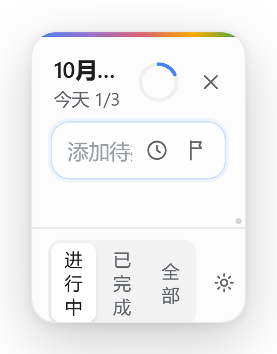
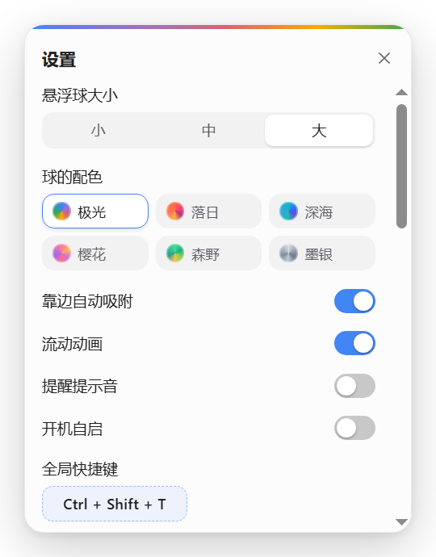
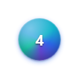
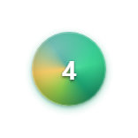

# 悬浮待办 FloatingTodo

> 一颗会流动的多彩球常驻屏幕边缘，点开就是待办清单。
> 学习通的作业、考试、分组任务、随堂练习自动同步进来，交完自动打勾。

<p align="center">
  
  &nbsp;&nbsp;&nbsp;
  
</p>

- Windows 10 / 11（64 位）· 免安装绿色版 · 数据全在本机
- Electron + 原生 HTML/CSS/JS，**没有框架、没有构建步骤**
- 许可证：[MIT](./LICENSE) · 需求文档：[`需求文档.md`](./需求文档.md) · 产品简述：[`产品简述-正式版.md`](./产品简述-正式版.md)

---

## 它解决什么

每天打开学习通翻三页才知道哪门课要交东西，抄进备忘录，然后连备忘录都忘了看。

悬浮待办把这件事变成：**屏幕边上一颗球，数字是还没做完的件数。点开就是清单，交完它自己打勾。**

---

## 功能

### 学习通自动同步（核心）

登录一次，程序在后台按固定间隔（默认 30 分钟，可调）巡查，把**有截止时间的**任务变成待办：

| 类型 | 同步 | 说明 |
|---|---|---|
| 作业 | ✅ | 未提交 / 待批阅 / 已批阅 |
| 考试 | ✅ | 按考试时间生成 |
| 分组任务 | ✅ | 与作业同源 |
| 随堂练习 | ✅ | 特殊处理，见下 |

- **完成状态自动回写**：你在学习通里交了，桌面上的待办自己打勾；已完成的不会反复复活。
- **随堂练习专项**：这类活动在学习通任务列表里**永远不会变成"已完成"**（列表里一直显示"进行中 · 剩余 X 天"，只有点进答题页才写"已提交"）。程序会对未打勾的随堂练习打开答题页核验，确认已提交才标记完成。
- **只收会过期的东西**：没有截止时间的通知、签到、纯浏览内容不会进清单。
- **登录**：通用学习通账号与学校站点分别登录一次，状态保存 7 天，重启不用重登；任何一路掉线都会明确提示，不会静悄悄不同步。
- **多学校支持**：学校自建站点地址因校而异，程序会从你已有的课程页地址里自动识别；识别不出来可以手动填一次（设置 → 学习通 → 学校学习通地址）。不需要学校入口就留空，不影响通用入口。

### 桌面体验

| 操作 | 效果 |
| --- | --- |
| 单击球 | 展开 / 收起面板 |
| 按住球拖动 | 松手记住位置；**拖到屏幕边缘附近会自动贴边**（角落可同时贴两条边，设置里可关） |
| 右键球 | 快捷菜单（新建 / 显示隐藏 / 打开数据目录 / 退出） |
| `Ctrl + Shift + T` | 全局唤出面板（可在设置里改） |
| 点面板外 / `Esc` | 收起面板 |
| 输入框 `Enter` | 立即添加，焦点留在输入框可连续录入 |
| 双击条目标题 | 就地改标题，`Enter` 保存、`Esc` 取消 |
| 悬停条目 | 「设时间 / 优先级 / 删除」 |

- **六套配色**：点一下立刻换，面板主色会跟着球一起变。
- **提醒**：到点弹系统通知 + 球跳三下 + 提示音；系统通知被 Windows 拦截时，后两者仍然生效。
- **三档大小**：小 / 中 / 大，换尺寸时球心位置不变。

| 极光（默认） | 落日 | 深海 | 樱花 | 森野 | 墨银 |
|:---:|:---:|:---:|:---:|:---:|:---:|
|  |  |  |  |  |  |

### 输入框支持自然语言

标题里直接写时间，提交前就能在输入框下方看到解析结果：

```
明天10点交报告        → 标题「交报告」，明天 10:00
周五开会              → 标题「开会」，本周五（全天）
下午3点半开会         → 今天 15:30
每天晚上8点吃药       → 每天重复，20:00
工作日 早上9点 打卡   → 工作日重复，09:00
!!! 修 bug            → 优先级 高（1~3 个感叹号 = 低/中/高）
3月5日交材料          → 明年 3 月 5 日（今年已过则明年）
```

**原则是「宁可不识别，也不猜错」**：没命中时间词时整句原样当标题。
重复任务只显示"当天这一次"，明天/后天的副本到那天才出现。

---

## 快速开始

### 方式一：直接下载（推荐给使用者）

到 [Releases](../../releases) 下载 `FloatingTodo-v*-win64.zip`，解压后双击 `FloatingTodo.exe`。

- 首次运行若提示「Windows 已保护你的电脑」→ 更多信息 → 仍要运行（未购买代码签名证书）
- 首次启动有引导页，按提示登录一次学习通即可
- 不需要安装 Node.js，不需要浏览器

### 方式二：从源码运行（开发者）

```powershell
npm install     # 会下载约 100MB 的 Electron 二进制
npm start
```

---

## 数据与隐私

- 数据全在本机 `%APPDATA%\FloatingTodo`，**不上传、不联任何服务器**
- 除登录学习通外无需注册账号；**不保存密码**，只保留登录后的会话凭据
- 免安装：解压即用，卸载即删文件夹

| 文件 | 说明 |
| --- | --- |
| `todos.json` | 主数据（原子写：先写 `.tmp` 再 rename） |
| `todos.prev.json` | 上一次成功保存的内容，主文件损坏时优先用它恢复 |
| `todos.backup.YYYYMMDD.json` | 每日一份，保留最近 7 份 |
| `app.log` | 运行日志（排查问题用） |

每次修改立即落盘；读到损坏的 JSON 会自动从备份恢复并提示，不会白屏。

---

## 免责声明

- 本项目是个人自用的桌面待办工具，**与超星 / 学习通官方没有任何关联**，也未获其授权。
- 「学习通同步」只使用**你自己的**登录状态，读取你自己账号里可见的作业与考试信息；
  程序不保存你的密码，不绕过任何验证码或权限校验。
- 自动化访问第三方服务可能与其用户协议存在冲突，**是否使用及后果由使用者自行判断和承担**。
- 数据只保存在本机，作者不收集任何信息；本项目按现状提供（见 [MIT](./LICENSE)），不承诺可用性与准确性。

---

## 已知限制

- **签到不同步**：签到是课堂内动作，做成待办没有意义，采集时会跳过。
- **学校入口需要"认识"你的学校**：程序从已有页面/域名自动推断学校站点地址，推断不出时需要你手动填一次（填完记住）。通用入口不受影响。
- **系统通知可能被 Windows 拦截**（专注助手 / 通知设置 / AUMID 未注册）。此时球跳动 + 提示音仍然生效。
- **开机自启只在打包后有效**：开发模式（`npm start`）会拒绝写注册表。
- **只测过 Windows 单屏 150% 缩放**：多显示器逻辑已写（跨屏夹取、断屏回主屏），但没有实机验证。
- 页面结构变了，采集规则要跟着调；规则集中在 `src/shared/chaoxing-collector.js`，有离线用例覆盖。

---

## 开发

### 命令

```powershell
npm start              # 启动
npm test               # 离线用例（本机接入接口 + 油猴脚本逻辑）
npm run test:parser    # 自然语言解析用例
npm run test:collector # 采集器用例（需要 Electron 窗口，会真开浏览器内核）
npm run pack           # 打包成 dist/FloatingTodo/FloatingTodo.exe
npm run icons          # 重新生成 PNG 图标
npm run sound          # 重新生成提示音
npm run make:bookmarklet  # 用本机令牌生成「接入书签」HTML
```

合计 70 余条离线用例，覆盖时间解析、采集规则、接入接口鉴权。

### 目录结构

```
floating-todo/
├─ src/
│  ├─ main/                主进程
│  │  ├─ main.js           窗口 / 托盘 / IPC / 快捷键 / 学习通同步 / 靠边吸附
│  │  ├─ store.js          JSON 存储、备份、迁移、设置校验
│  │  ├─ reminder.js       提醒调度（20s 一轮）
│  │  └─ ingest.js         本机接入接口（127.0.0.1 + 令牌）
│  ├─ preload/
│  │  ├─ preload.js        contextBridge 白名单
│  │  └─ backdrop.js       面板外部点击「挡板」
│  ├─ shared/
│  │  ├─ parser.js         自然语言 → { 标题, 时间, 重复, 优先级 }
│  │  └─ chaoxing-collector.js  学习通页面采集规则（主进程 + 油猴脚本共用）
│  └─ renderer/
│     ├─ ball/             悬浮球（配色主题在 ball.css 的 data-ball-theme）
│     └─ panel/            待办面板 + 设置抽屉
├─ userscript/             油猴脚本（备用通道）
├─ scripts/                生成脚本、测试、UI 自动化验证工具
├─ docs/screenshots/       README 用的截图
├─ 需求文档.md              需求与设计规格
└─ 产品简述-正式版.md        对外的产品说明
```

### 打包方式

`npm run pack` 不是 electron-builder，而是「复用本地 `node_modules/electron/dist` + 打进源码」：

- 不需要联网拉 NSIS / winCodeSign，离线也能出包（本机网络受限时的产物）
- 不开 asar，`resources/app/` 下就是明文源码，方便改样式再试
- 想做成便携版（数据跟文件夹走）：`$env:FLOATING_TODO_HOME="D:\某目录\data"` 再启动

### 调试用环境变量

| 变量 | 作用 |
| --- | --- |
| `FLOATING_TODO_HOME=<dir>` | 数据 / 缓存 / userData 全部重定向（沙箱测试、便携版） |
| `FLOATING_TODO_OPEN_PANEL=1` | 启动后自动展开面板（截图、演示） |
| `FLOATING_TODO_OPEN_SHEET=1` | 面板打开时直接进设置 |
| `FLOATING_TODO_SAVE_ALL=1` | 把抓取的页面 HTML 存到数据目录（调采集规则用） |
| `FLOATING_TODO_DUMP_COOKIES=1` | 打印学习通 cookie 的域名与有效期（排查掉登录） |

### 踩过的坑（值得先看一眼）

- **`setIgnoreMouseEvents(true, { forward: true })` 在透明窗口上不转发 mousemove**：渲染层收不到事件 → hover 永不触发 → 窗口一直忽略点击 → 球点不动。现在改成主进程轮询光标坐标做命中判定。
- **透明 + 置顶窗口要关掉 Chromium 的遮挡计算**（`CalculateNativeWinOcclusion`）：一旦它认为窗口被挡住就停止重绘，而 Windows 上透明窗口的鼠标命中区是按上次绘制结果算的 —— 表现就是"球看得见、悬停有效、但点不动"。
- **面板收起不能只靠 `blur`**：如果窗口本来就没抢到焦点，你点别处它不会收到失焦事件，面板就永远关不掉。现在用一层全屏透明"挡板"接住外部点击（`src/preload/backdrop.js`）。
- **命中判定必须用窗口中心**（`bounds.x + bounds.width / 2`），不能用 `pad + size/2`：窗口尺寸会被 DPI 取整误差逐步撑大（实测 80 → 84 → 85 → …），固定偏移算出的圆心会偏掉。
- **点击/拖动阈值不能太小**：150% 缩放下手抖就有 7~8px，4px 判定会把每次点击当成拖动。
- **不要写 `const api = window.api`**：`contextBridge` 暴露的属性不可配置，同名 `const` 会让整个脚本抛 `SyntaxError` 不执行，页面全透明。项目里统一用 `bridge`。
- **学习通的作业截止时间是「剩余X小时Y分钟」倒计时**，每次换算成绝对时间都会差几十秒，所以只在新旧时间差 > 2 分钟时才更新，避免反复重置提醒。
- **PowerShell 5.1 `Get-Content -Raw` 默认按 GBK 读 UTF-8**，`Set-Content -Encoding UTF8` 还会加 BOM 把 JSON 读坏；脚本里统一用 `[System.IO.File]::ReadAllText($p, [Text.Encoding]::UTF8)`。

---

## License

[MIT](./LICENSE) © 2026 Leo Zhu
